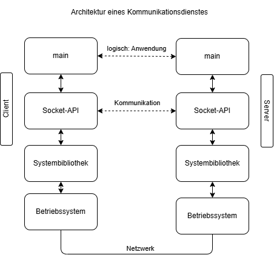

# PRE-LAB

## 1.
Was sind die zwei Hauptunterscheidungsmerkmale von UDP und TCP?
(Modul "Allgemeine Konzepte" aus Vorlesung) 

* **Verbindung:** TCP ist verbindungsorientiert, UDP verbindungslos
* **Zuverlässigkeit:** TCP garantiert Vollständigkeit und Reihenfolge (inkl. Fluss-/Staukontrolle), UDP nicht ("best effort")

## 2.
Durch welche 2 Adressbestandteile kann ich überall auf der Welt einen bestimmten Server ansprechen?

* **IP-Adresse:** identifiziert den Rechner (Host) weltweit
* **Portnummer:** identifiziert die Anwendung (den Server-Prozess) auf diesem Rechner


Beispiel: 141.37.11.5:80 (Webserver)

## 3.
Machen Sie eine Skizze der "Architektur eines Kommunikationsdienstes" und
zeichnen Sie in diese Skizze ein: 1. wo das main-Programm einer Anwendung
lokalisiert ist 2. wo das Socket-API lokalisiert ist, welches diese Anwendung zur
Kommunikation verwendet 3. wo die Systembibliothek lokalisiert ist, welches die
Socket-Operationen bereitstellt.



## 4.
Welche Funktionen werden zur UDP- Socketprogrammierung benötigt? Machen Sie
zwei Spalten mit Systemaufrufen, solche welche auf dem Client und solche welche auf
dem Server verwendet werden. 

| Client     | Server     |
|------------|------------|
| `socket`   | `socket`   |
|            | `bind`     |
| `sendto`   | `recvfrom` |
| `recvfrom` | `sendto`   |
| `close`    | `close`    |

* bind ist nur beim Server nötig, damit er auf einem festen, bekannten Port lauscht. Beim Client vergibt der Kernel beim ersten sendto automatisch einen freien Port.
* Kein listen, accept oder connect: Das sind TCP-Aufrufe für den Verbindungsaufbau. UDP ist verbindungslos, deshalb kommen sie hier nicht vor.
* In deinem Server wird close nie erreicht, weil er in einer Endlosschleife läuft. Für die Tabelle gehört es trotzdem dazu.

## 5.
Informieren Sie sich im Internet über die Funktionsweise der Funktion fgets (..).
Schreiben Sie ein kleines Programm, welches mit fgets eine Zeile von Konsole einliest
und sie wieder dort ausgibt. 

```c
#include <stdio.h>

int main(){

    char buffer[10];
    fgets(buffer, sizeof(buffer), stdin);
    printf("%s", buffer);
}
```

## 6.
Wie werden in ANSI C (C89/90) Integer in Strings umgewandelt?

In C89/90 gibt es dafür nur sprintf aus <stdio.h>. Es funktioniert wie printf, schreibt aber in einen Buffer statt auf die Konsole:

```c
#include <stdio.h>

int main(void) {
    int zahl = 42;
    char str[12];               /* reicht für jeden 32-bit int inkl. '-' und '\0' */
    sprintf(str, "%d", zahl);
    printf("%s\n", str);
    return 0;
}
```

## 7.
Definieren Sie in C eine Variable mystring, die den String "Hallo" enthält?

```c
char mystring[] = "Hallo";
```
Der Compiler legt ein Array mit 6 Bytes an: 5 Zeichen plus das automatisch angehängte '\0'. Also gilt sizeof(mystring) == 6 und strlen(mystring) == 5.

Es gibt 2 Alternativen:
```c
char mystring[6] = "Hallo";         /* Größe explizit, muss Platz für '\0' haben */
const char *mystring = "Hallo";     /* Pointer auf String-Literal, nicht änderbar */
```

## 8.
Wie sieht der Speicher aus, der mystring enthält? Geben Sie die Hexadezimalwerte
jedes belegten Bytes an (Hinweis: verwenden Sie eine ASCII-Tabelle). 

```
H  a  l  l  o  \0
48 61 6C 6C 6F 00
```

## 9.
Welchen Wert liefert strlen(mystring)? 

5