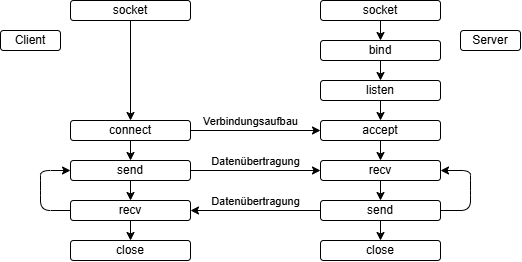

# PRE-LAB

## 1.
Was bedeutet es, dass das TCP-Protokoll bytestreamorientiert ist? (siehe
Vorlesungsteil "Netzwerkprogrammierung" im Kapitel "Allgemeine Konzepte") 

TCP überträgt einen fortlaufenden **Strom von Bytes ohne Nachrichtengrenzen**.
Die Aufteilung beim Senden (wie oft und mit welcher Länge `send` aufgerufen wird)
bleibt beim Empfänger nicht erhalten: Ein `recv` kann Teile einer Nachricht,
genau eine oder mehrere Nachrichten zusammen liefern.

Ablauf: `send` kopiert die Daten in den Sendepuffer des Kernels. Der TCP-Stack
teilt sie nach eigenem Ermessen in Segmente auf (abhängig von MSS, Fenstergröße,
Nagle-Algorithmus). Beim Empfänger landen die Bytes im Empfangspuffer des Kernels,
und `recv` kopiert davon so viel, wie gerade vorhanden ist und in den Buffer passt.

Garantiert ist nur die **Reihenfolge und Vollständigkeit der Bytes**, nicht die
Grenzen der Nachrichten.

## 2.
Wenn Sie bei UDP nacheinander die Strings "AAA", "BBB", "CCC" als einzelne
Nachrichten versenden, welche Nachrichten kommen auf der anderen Seite an, wenn
es keine Fehler auf der Leitung gibt?

"AAA", "BBB", "CCC"

## 3.
Wenn Sie bei TCP nacheinander die Strings "AAA", "BBB", "CCC" als einzelne
Nachrichten versenden, Nachrichten welchen Inhalts könnten in diesem Fall auf der
anderen Seite ankommen?

* Beispiel 1: "AAA", "BBBCCC"
* Beispiel 2: "AAABBB", "CCC"

Jede Aufteilung ist möglich, nur die Reihenfolge der Bytes bleibt erhalten.

## 4.
Welche Aufgabe muss bei einer bytestreamorientierten Kommunikation die
Anwendung übernehmen? Wie kann sie diese Aufgabe realisieren?

Bei einer bytestreamorientierten Kommunikation muss die Anwendung die Trennung der Nachrichten selbst realisieren, z.B. durch Einfügen eines vordefinierten Trennzeichens oder das Mitsenden der Länge einer Nachricht.

## 5.
Welche Dienstelemente verwenden Client und Server, um über TCP Daten
miteinander auszutauschen? Zeichnen Sie ein Flussdiagramm mit den
Dienstprimitiven (socket, connect, usw.) für Client und für Server, wie in der
Vorlesung vorgestellt.




## 6.
Wie geben Sie über ein printf den Inhalt eines Buffers „char buf[40]“ hexadezimal
aus? C-Code:

```c
for (int i = 0; i < sizeof(buf); i++) {
    printf("%02X ", (unsigned char)buf[i]);
}
printf("\n");
```