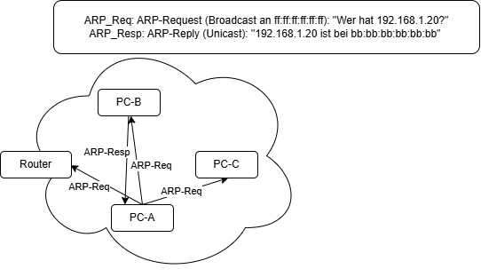

# PRE-LAB

## 1.
Sie müssen in diesem Laborversuch Ihre Abgabe für Laboraufgabe 1 (d.h. das UDP
Statistik-Programm) wieder verwenden. Stellen Sie sicher, dass Sie die letzte
(lauffähige) Version des Programms zugreifbar haben.
Programm in Labor zugreifbar? --> Ja

## 2.
Angenommen eine Anwendung kommuniziert über UDP. Zeichnen Sie den
Protokollstapel (Stack) unterhalb der Anwendung ( siehe Vorlesungsteil "Allgemeine
Konzepte" - "Einführung in Netzwerkprogrammierung" – "Enveloping", Folien 2-
31ff).

* Layer 4 --> UDP
* Layer 3 --> IP (IPv4)
* Layer 1/2 --> Ethernet (IEEE 802.3), alternativ WLAN (802.11)

## 3.
Mit ihrem Programm von Laboraufgabe 1 überträgt ein Kommilitone seine Bank-PIN
"9924\n". Sie hacken die Leitung. Welche Abfolge von Headern/Trailern und
Nutzdaten erwarten Sie. Machen Sie eine Skizze. Markieren Sie die Stelle an der
die PIN steht mit '*'. (Tipp: obige Folien helfen auch hierbei!)

```
PIN
-> UDP-Header | PIN
-> IP-Header | UDP-Header | PIN
-> Ethernet-Header | IP-Header | UDP-Header | PIN | Ethernet-Trailer
```

```
+-----------------+-----------+------------+-------------+----------+-----------+
| Ethernet-Header | IP-Header | UDP-Header | * 9924 *    | Padding  | Ethernet- |
| 14 Byte         | 20 Byte   | 8 Byte     | 4 Byte      | 14 Byte  | Trailer   |
| (MAC Ziel/Quelle| (IP Quelle| (Port      | 39 39 32 34 |          | (FCS)     |
|  Typ 0x0800)    |  /Ziel)   | Quelle/Ziel|             |          | 4 Byte    |
+-----------------+-----------+------------+-------------+----------+-----------+
                                            ^
                                            PIN ab Byte 42 im Frame
```

## 4.
Was denken Sie sind 4 wichtige Felder des Ethernet-Headers, wie wir sie in der
Vorlesung besprochen haben. (Nur Namen, keine Beschreibung)

* Ziel-MAC-Adresse
* Quell-MAC-Adresse
* Präambel/Start Frame Delimiter (SFD)
* EtherType (z.B. IPv4, ARP)
* Cyclic Redundancy Check (CRC) Prüfbits -> im Trailer

## 5.
Recherchieren Sie 4 wichtige Felder des IP-Headers (Nur Namen, keine
Beschreibung). 

* Quell-IP-Adresse
* Ziel-IP-Adresse
* Time To Live (TTL)
* Protokoll (UDP, TCP, ICMP, IGMP, OSPF, ...)

## 6.
Recherchieren Sie, welche Felder ein UDP-Header hat?

* Quell-Port
* Ziel-Port
* Länge (Header + Daten)
* Prüfsumme (Checksum)

## 7.
Geben Sie ein Beispiel für eine Ziel-Adresse des Ethernet-Protokolls.

* 0e:c6:06:5c:2e:52
* Broadcast: ff:ff:ff:ff:ff:ff, an alle Geräte im LAN, z. B. für ARP-Anfragen.
* Multicast: 01:00:5e:xx:xx:xx, für IPv4-Multicast.

## 8.
Wozu dient das ICMP-Protokoll? 

ICMP (Internet Control Message Protocol) dient zur Übermittlung von
**Fehler- und Statusmeldungen** auf IP-Ebene, z.B.:
* Ziel nicht erreichbar (Destination Unreachable, z.B. Port Unreachable)
* TTL abgelaufen (Time Exceeded) -> Grundlage von `traceroute`
* Echo Request / Echo Reply -> Grundlage von `ping` (Erreichbarkeit, Round-Trip-Time)

ICMP wird direkt in IP verpackt (IP-Protokollnummer 1) und nutzt keine Ports.

## 9.
Wozu dient das ARP-Protokoll? 

ARP (Address Resolution Protocol) ermittelt zu einer bekannten IP-Adresse die
zugehörige MAC-Adresse im **lokalen Netz**:
* ARP-Request als Broadcast (ff:ff:ff:ff:ff:ff): "Wer hat IP x.x.x.x?"
* ARP-Reply per Unicast vom Besitzer der IP: "Ich, meine MAC ist ..."
* Ergebnis wird im ARP-Cache zwischengespeichert
* Liegt das Ziel außerhalb des Subnetzes, wird die MAC des Gateways aufgelöst

ARP liegt direkt in Ethernet (EtherType 0x0806), nicht in IP.

## 10.
Wie funktioniert das ARP-Protokoll, machen Sie eine Skizze.



```
   PC-A                      PC-B                  PC-C               Router
   IP  .10                   IP  .20               IP  .30            IP  .1
   MAC aa:..                 MAC bb:..             MAC cc:..          MAC rr:..
     |                          |                     |                  |
     |  (1) ARP-Request, Broadcast ff:ff:ff:ff:ff:ff: "Wer hat .20?"      |
     |------------------------->|-------------------->|----------------->|
     |                          |                  verwirft           verwirft
     |  (2) ARP-Reply, Unicast an aa:..: ".20 ist bb:.."                  |
     |<-------------------------|                     |                  |
     |                          |                     |                  |
   (3) Cache-Eintrag: .20 -> bb:..
     |  (4) eigentliches IP-Paket an MAC bb:..
     |------------------------->|
```
